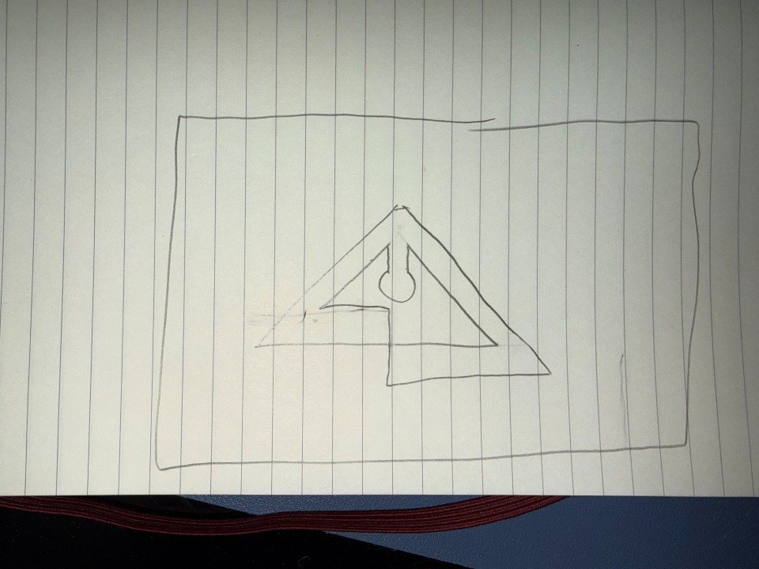

## November 5, 2026: <Brand New Start>

**I Am Outlining Some of Parameters For My MP3 Player**

I debated whether or not to make my own PCB via KiCad but decided against it due to its complexity and my lack of PCB design experiance.
Instead, I will use this ESP-32 [Screen:](https://www.amazon.com/FREENOVE-Display-ESP32-S3-240x320-Non-Touch/dp/B0FSQLPQ6M)

   

Along with this screen I will also buy this  [DAC:](https://www.amazon.com/ACEIRMC-Lossless-Digital-Converter-Raspberry/dp/B08YNJGSN4)

And A battery that looks something like  [This:](https://www.amazon.com/JLJLUP-Rechargeable-Integrated-Protection-Development/dp/B0FH9XHXRT)

All totaling to ~44$. Not bad, not bad at all.

**Now it's time for the game plan.**
I've done some research over what I am going to do,
Here's the gist:
* I need to solder the BCK, DIN and SCK pins to the ESP-32 as I don't have access to the correct GPIO pins on the current board,
* For coding, core 1 will be used for the audio decoding while core 0 will be used for wifi, bluetooth, SD card reading and whatever else needs to be done.
  - This is so the audio that is decoded stays crisp and stable.
  - and frankly because anything else can studder and I don't think anyone would care.
* I also want decrease the amount of uncalled for noise on the DAC by:
  - Using a power regulator or adding a 10 microF plus a 0.1 microF ceramic capacitor.
  - Use short, tidy wiring and keep them away from other components.

*Fun fact: I actually almost lost this whole entry due to me pressing the back button on my mouse, thank god for session storage :)*

**Logo Time!**
I was thinking that since I am calling this thing the "Delta" MP3 player I should make the logo a triangle, so I drew a little scretch:

> **Why** does it look like that?

I don't know, I thought it was cool.

Well that will do it for today. I quite enjoyed researching my parts and outlining a plan. Now that I think about it I should implement an actual goal for this project, but that will have to wait until tommorrow.
In short:
* I found the parts I needed
* I outlined some of the wiring and procedures
* I outlined some coding required

Hopefully I'll make these entrees more polished soon, but for now I'm going to bed, goodnight!

**Total time spent: 2h**
